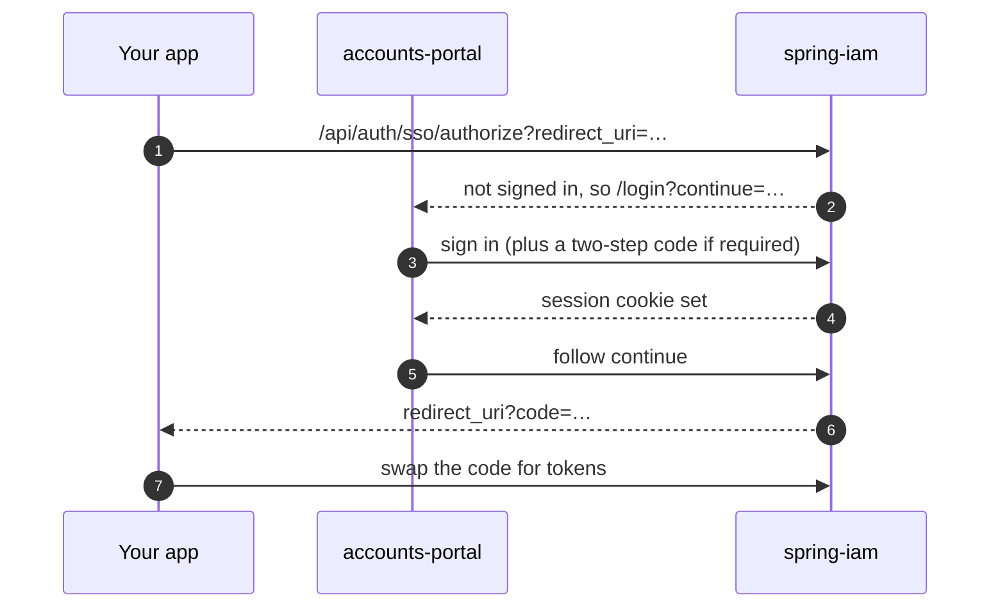

<div align="center">


# accounts-portal

Ready-made sign-in pages for [spring-iam](https://github.com/mesubash/spring-iam).<br />
Sign in, sign up, password reset, email verification and two-step verification, in front of every app you run.

[](https://accounts-portal.vercel.app)
[](https://github.com/mesubash/accounts-portal/actions/workflows/ci.yml)
[](LICENSE)
[](https://github.com/mesubash/spring-iam)


</div>

> [!TIP]
> **Try it in ten seconds:** open the [live demo](https://accounts-portal.vercel.app). There's no backend and any password works.
> Sign in as `mfa@example.com` (code `123456`) or `enroll@example.com` to see two-step verification.

## How it fits

spring-iam is API-only. Your apps send signed-out users here; after they sign in, spring-iam sends them back with a one-time code.



## Pages

| Page               | What happens                                                                     |
| ------------------ | -------------------------------------------------------------------------------- |
| `/signin`          | Email and password, plus any social providers spring-iam has turned on           |
| `/signup`          | Create an account; spring-iam emails a verification link                         |
| `/verify-email`    | Opened from that email (`?token=`)                                               |
| `/forgot-password` | Request a reset link, with a resend countdown                                    |
| `/reset-password`  | Opened from the reset email (`?token=`)                                          |
| `/mfa`             | Six-digit code from an authenticator app, or a recovery code                     |
| `/mfa/enroll`      | First-time two-step setup: scan a QR code, confirm, save one-time recovery codes |
| `/oauth/callback`  | Where spring-iam returns after Google sign-in                                    |

`/login` redirects to `/signin`, which is spring-iam's default login URL.

Every page sits on an access badge. The band across its top shows where you are: 🟦 mid-flow, 🟩 it worked, 🟥 a link expired or failed.

## Quick start

<details open>
<summary><b>Demo mode</b>: no backend needed</summary>

<br />

```sh
bun install
VITE_DEMO=true bun run dev        # http://localhost:3000
```

Every request is answered in the browser. A notice under the form lists the test accounts:

| Email                 | What it shows                                                   |
| --------------------- | --------------------------------------------------------------- |
| `you@example.com`     | Signs straight in                                               |
| `mfa@example.com`     | Asks for a code: `123456`, or recovery code `a1b2c3d4-e5f60718` |
| `enroll@example.com`  | Two-step setup, then recovery codes (code `123456`)             |
| any, password `wrong` | The error state                                                 |

`/verify-email?token=demo` and `/reset-password?token=demo` stand in for the email links; `token=bad` shows the failure.

</details>

<details>
<summary><b>With spring-iam</b></summary>

<br />

```sh
IAM_URL=http://localhost:8080 bun run dev
```

The app server proxies `/api/**` to `IAM_URL`, so spring-iam's session cookie is set on this origin.
On the spring-iam side, point its frontend here and allow the OAuth callback:

```sh
APP_FRONTEND_URL=https://accounts.example.com
APP_ALLOWED_REDIRECT_URIS=https://accounts.example.com/oauth/callback
```

</details>

## Configuration

Copy `.env.example` to `.env`. All values are read at build time.

| Variable               | Default                 | Purpose                                                       |
| ---------------------- | ----------------------- | ------------------------------------------------------------- |
| `VITE_APP_NAME`        | `Accounts`              | Name in the header, page titles and the recovery-code file    |
| `IAM_URL`              | `http://localhost:8080` | Where `/api/**` is proxied                                    |
| `VITE_TRUSTED_ORIGINS` | (empty)                 | Extra origins `?continue=` may send users to, comma-separated |
| `VITE_DEMO`            | (off)                   | `true` answers the API in the browser. Demos only             |

To rebrand the colour, change `--brand` in [`src/styles.css`](src/styles.css): one value for light, one for dark.

## Deploy

```sh
IAM_URL=https://iam.internal:8080 bun run build
bun run start                     # node .output/server/index.mjs on port 3000
```

A plain Node server: put it behind your usual TLS proxy.

> [!WARNING]
> Never build with `VITE_DEMO=true` in front of a real IAM. Demo mode accepts any password.

## Security

- **No open redirect.** After sign-in, `?continue=` is followed only to this origin or to `VITE_TRUSTED_ORIGINS`.
- **Tokens stay out of URLs.** MFA challenge and enrolment tokens live in browser history state, away from logs and `Referer` headers.
- **Secrets stay local.** The TOTP QR code is drawn in the browser, never by a QR service.
- **No third-party calls.** Fonts are self-hosted, so nobody else sees who opens the sign-in page.

## Development

```sh
bun run lint && bun run typecheck && bun run test && bun run build
```

```
src/
├── routes/        one file per page
├── components/    badge frame, form fields, buttons, demo notice
└── lib/
    ├── api.ts     spring-iam client: envelope, errors, login outcomes
    ├── oidc.ts    continue-URL checks
    ├── demo.ts    in-browser fake IAM for demo mode
    └── *.test.ts  Vitest
```

**Not included yet:** spring-iam's optional SSO consent screen, and account settings
(change password, turn two-step off, sessions). This portal covers signing in.

## License

[MIT](LICENSE)
